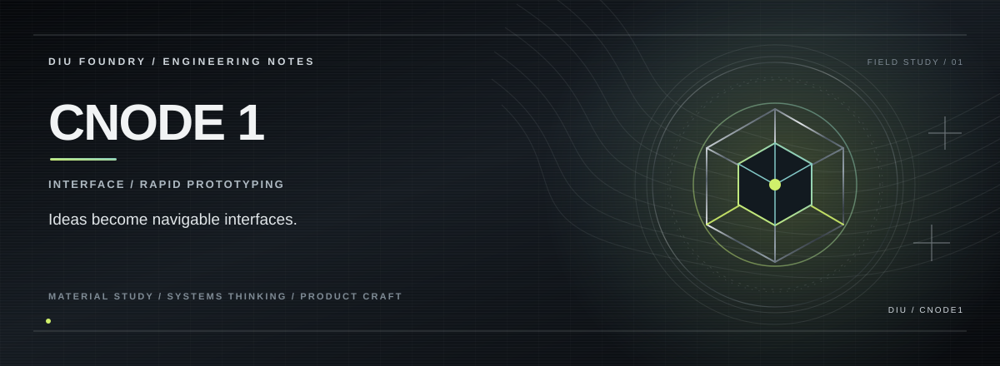

> **RAPID PRODUCT INTERFACE LAB.**

## THE PREMISE

CNode 1 is a deliberately fast product-prototyping space: a React/TypeScript shell for turning an idea into a navigable interface, testing interaction patterns, and validating the shape of a product before the heavier systems arrive.

## THE EXPERIENCE

**Start with the interface, not the ceremony.**  
**Keep components composable.**  
**Make every prototype easy to evolve.**

## THE SYSTEM

React 18 + TypeScript + Vite form the core. React Router handles navigation, TanStack Query keeps the data boundary ready, while Tailwind/shadcn/ui provide the visual primitives. Vitest covers the test surface.

## THE STACK

React 18 · TypeScript · Vite · Tailwind CSS · shadcn/ui · React Router · TanStack Query · Vitest

## RUN

Requirements: Node.js and npm.

```bash
npm ci
npm run dev
```

For verification and a production build:

```bash
npm run lint
npm test
npm run build
```

The project uses Vite, TypeScript and Vitest.

## PROJECT STATE

**Prototype / active experimentation**

The repository documents the capabilities that are actually implemented; future integrations are intentionally separated from the current product surface.

---

<p align="center"><strong>K. KISHOR KUMAR</strong><br><sub>ENGINEERING / PRODUCT / SYSTEMS</sub></p>
